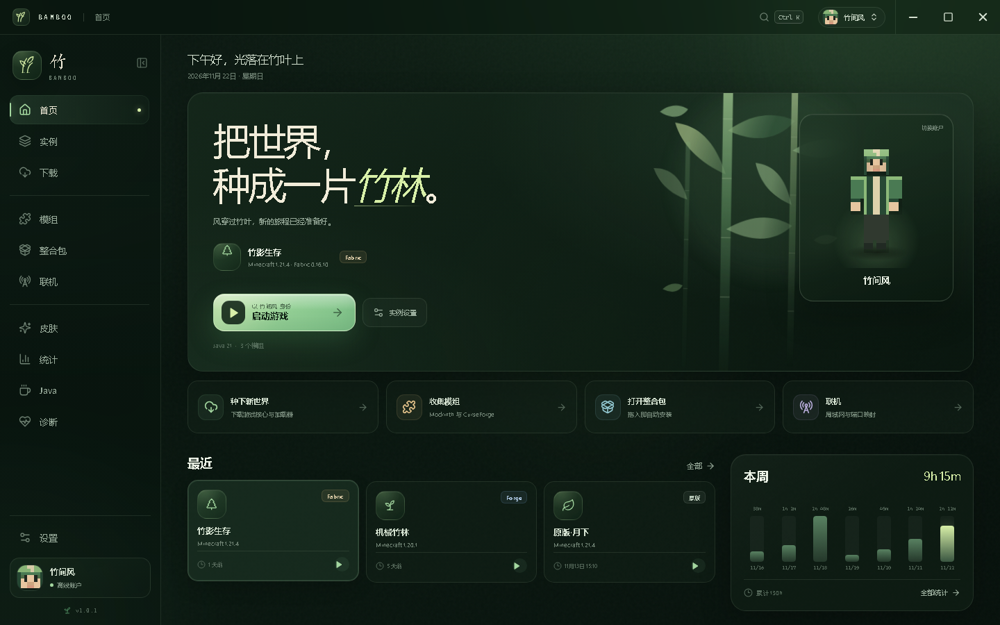
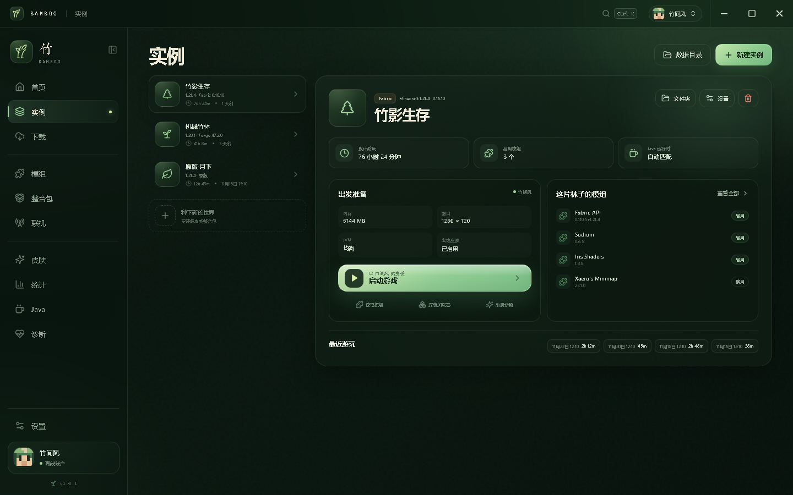
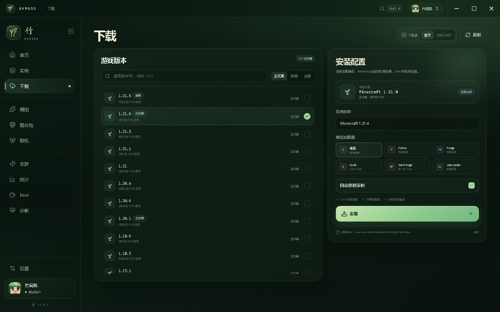
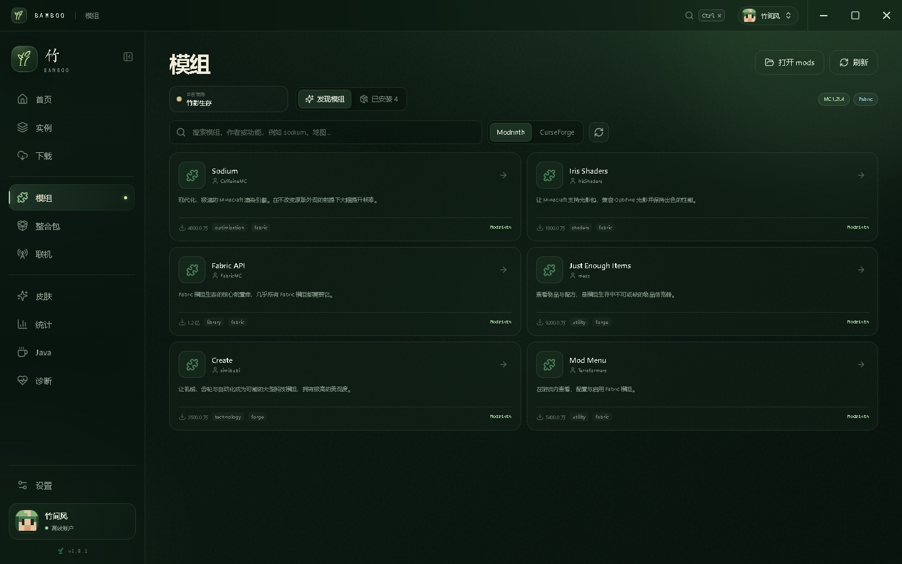
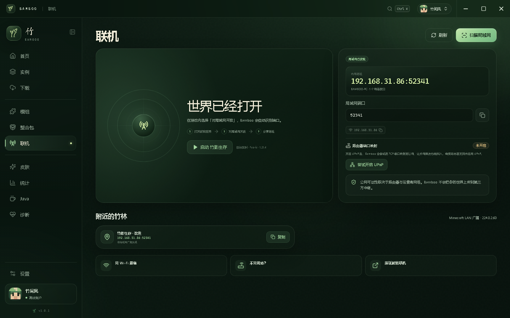
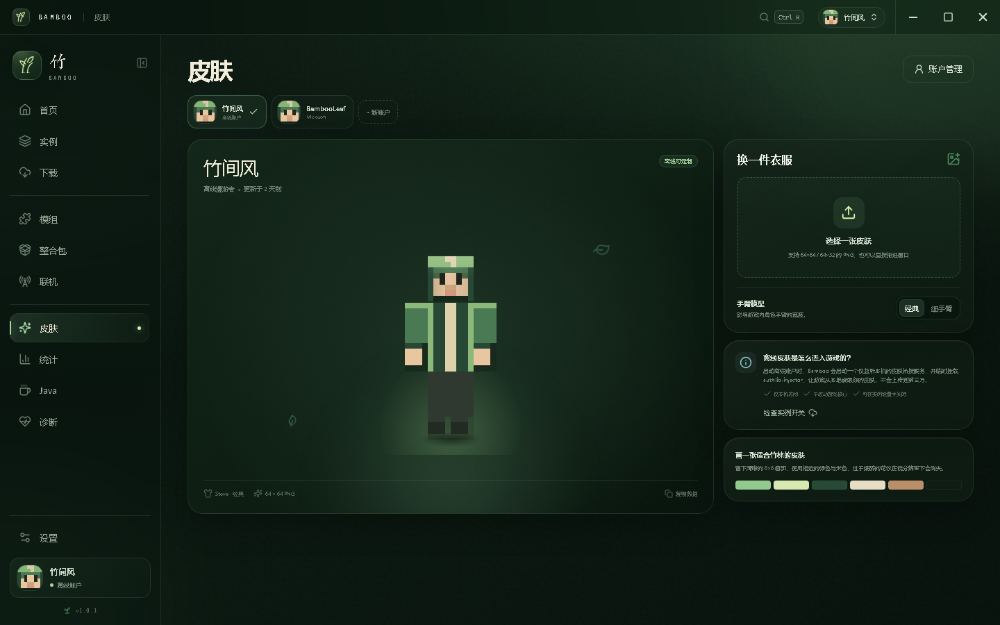
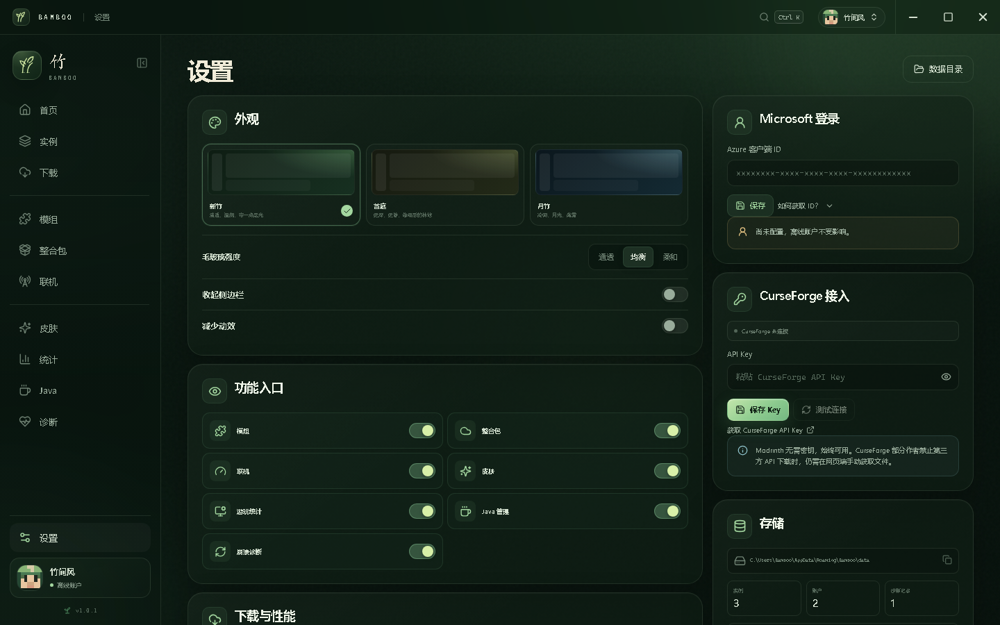
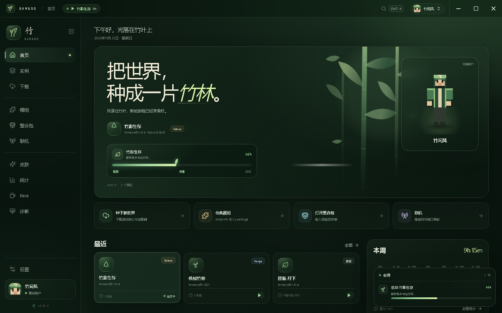
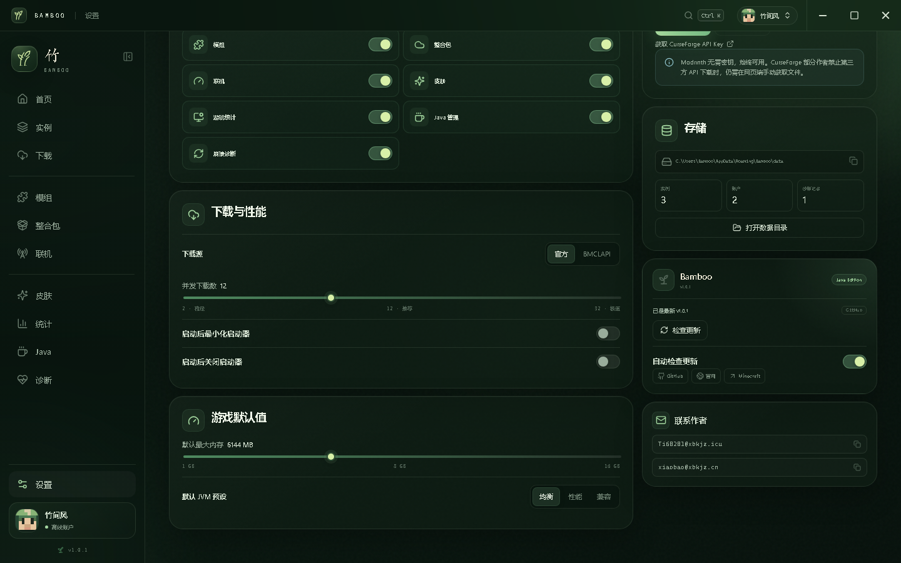

# Bamboo · 竹启动器

> 把世界，种成一片竹林。 · v1.0.1

Bamboo 是一款面向 Minecraft Java 版的桌面启动器：竹青毛玻璃界面、离线 / Microsoft 账户、游戏与加载器安装、Modrinth / CurseForge 模组、拖入整合包、本地联机、Java 管理、多实例、崩溃分析、游玩统计与自动更新检查。



## 现在可以做什么

| 能力 | 状态 | 说明 |
| --- | --- | --- |
| 竹元素毛玻璃 UI | 已实现 | 无边框窗口、毛玻璃面板、竹叶动效、三种主题、透明度与动效开关 |
| 离线账户 | 已实现 | 3–16 位用户名，UUID 与离线服务端兼容；本地皮肤 |
| Microsoft 账户 | 已实现，需配置 | OAuth 2.0 设备代码流；需在设置中填写自己的 Azure 应用 ID |
| 下载游戏核心 | 已实现 | Mojang 版本清单；官方 / BMCLAPI 双源；断点续传式文件校验 |
| 一键加载器 | 已实现 | Fabric、Forge、Quilt、NeoForge、LiteLoader；自动匹配 Java |
| 快速启动 | 已实现 | 启动前检查文件与 Java；G1 调优预设；窗口就绪时间约 2–3 秒（1.8.9 实测） |
| 多实例 | 已实现 | 每个实例独立 gameDir、模组、存档、Java、内存、分辨率与 JVM 参数 |
| Mod 搜索 / 下载 / 安装 | 已实现 | Modrinth 开箱即用；CurseForge 需 API Key；递归安装必需前置 |
| 拖入整合包 | 已实现 | Modrinth `.mrpack`、CurseForge、MultiMC / Prism；自动创建实例 |
| 本地联机 | 已实现 | LAN 广播发现、日志端口识别、本机地址分享、UPnP TCP 映射 |
| 离线皮肤 | 已实现，实验性 | 本地 Yggdrasil 皮肤桥 + authlib-injector；测试于 1.8.9 |
| Java 管理 | 已实现 | 扫描常见安装位置；下载 Java 8 / 16 / 17 / 21 / 25 |
| 崩溃分析 | 已实现 | crash-report / latest.log 规则匹配；定位疑似模组并给出建议 |
| 游玩时长 | 已实现 | 每次会话、实例累计、近 7 天与最近记录 |
| 功能入口显隐 | 已实现 | 模组、整合包、联机、皮肤、统计、Java、崩溃诊断可独立隐藏 |
| 自动检查更新 | 已实现 | 启动时查询 GitHub Releases、GitHub 源码版本与官网版本；有更新时提示并可下载发布资产 |
| 联系作者 | 已实现 | 设置页底部展示 `Ti68281@xbkjz.icu` / `xiaobao@xbkjz.cn`，点击复制 |

## 截图

| 实例 | 下载 |
| --- | --- |
|  |  |
| **模组** | **联机** |
|  |  |
| **皮肤** | **设置** |
|  |  |
| **启动进度** | **更新与联系作者** |
|  |  |

## 快速开始

### 使用便携版

1. 解压 `release/Bamboo-Portable-1.0.1.zip`。
2. 双击 `Bamboo.exe`。
3. 点击左下角账户卡片，创建离线账户，或配置 Microsoft 登录。
4. 前往「下载」安装游戏。首次会下载核心、资源与运行库。

> 便携版未做代码签名，Windows SmartScreen 可能出现“未知发布者”提示。可以选择“更多信息 → 仍要运行”。
>
> 便携版不写入注册表；游戏数据保存在 `%APPDATA%\Bamboo\data`。删除程序文件夹即可卸载启动器。

### 自动更新

- 启动器默认在启动后自动检查更新，可在「设置 → 关于 / 更新」中关闭。
- 依次查询 [GitHub Releases](https://github.com/Ti-68281/Bamboo-Launcher/releases)、仓库 `main` 分支的 `package.json`，以及官网 `version.json` / `update.json`（不存在时解析下载页版本）。更新检查使用 Electron 的 `net.fetch`，兼容系统代理。
- 当前已发布 [v1.0.1](https://github.com/Ti-68281/Bamboo-Launcher/releases/tag/v1.0.1)。
- 发现新版本后会在设置页显示版本号与来源；若发布资产包含 Windows `.exe` / `.zip`，可直接下载到数据目录的 `cache/updates`。
- 下载完成后需要在关闭 Bamboo 的情况下运行安装包或替换便携版文件，启动器不会静默覆盖正在运行的自身文件。

### 开发运行

环境：Node.js ≥ 22、pnpm ≥ 10、Windows 10/11。

```powershell
pnpm install
pnpm dev
```

首次安装 Electron 时如果 pnpm 询问构建许可，请在 `pnpm-workspace.yaml` 中保留：

```yaml
allowBuilds:
  electron: true
  esbuild: true
  electron-winstaller: true
```

### 构建

```powershell
pnpm typecheck
pnpm build
pnpm package:portable     # 生成 release/Bamboo-Portable + zip
pnpm package:dir          # electron-builder 目录包（可选）
```

当前交付使用自带的便携打包脚本 `scripts/package-portable.mjs`，绕过 electron-builder 在本机环境中的工具下载问题。打包脚本会：

- 用 `@electron/asar` 生成 `resources/app.asar`；
- 复制 Electron 运行时；
- 用 `rcedit` 写入图标与版本信息（若 `.tools/winCodeSign` 不存在则跳过）；
- 使用 `7zip-bin` 生成 `Bamboo-Portable-1.0.1.zip`。

## 首次配置

### Microsoft 登录（可选）

Microsoft 不允许任意应用直接复用其他启动器的客户端 ID。Bamboo 使用标准 OAuth 2.0 设备代码流，因此需要你自己的 Azure 应用 ID：

1. 打开 [Azure 应用注册](https://portal.azure.com/#view/Microsoft_AAD_RegisteredApps/ApplicationsListBlade)。
2. 新建应用，账户类型选择“个人 Microsoft 账户”。
3. 在“身份验证”中启用“允许公共客户端流”。
4. 将“应用程序(客户端) ID”填入 Bamboo「设置 → Microsoft 登录」并保存。
5. 在账户面板点击“使用 Microsoft 登录”，在浏览器输入一次性代码。

Bamboo 不会接触密码；访问令牌使用 Windows 系统密钥环（Electron `safeStorage`）加密后保存在本机。

### CurseForge（可选）

1. 在 [CurseForge 开发者控制台](https://console.curseforge.com/) 申请 API Key。
2. 填入 Bamboo「设置 → CurseForge 接入」，保存并测试连接。
3. 在模组页切换到 CurseForge。

未配置密钥时，Modrinth 仍完全可用。CurseForge 部分项目受作者授权限制，第三方 API 不提供下载地址，此时 Bamboo 会给出明确提示。

### 离线皮肤

1. 账户面板创建离线账户时可选 PNG，或之后在「皮肤」页上传。
2. 皮肤必须为 64×64 或 64×32 的 PNG；Bamboo 会重新编码以去除无关元数据。
3. 在实例设置中保持“离线皮肤桥接”开启（默认开启）。
4. 启动时 Bamboo 会：
   - 从 authlib-injector 官方源下载约 300 KB 的 agent（缓存在 `data/runtime`）；
   - 启动仅监听 `127.0.0.1` 的本地 Yggdrasil 皮肤服务；
   - 通过 `-javaagent` 注入，让游戏读取本地签名皮肤。
5. 服务只在本机监听，结束后仍随启动器退出；不会上传皮肤。

> 这是实验性能力：已在 Minecraft 1.8.9 上验证 javaagent 注入、Yggdrasil profile 与 RSA-SHA1 签名。极少数整合包或服务端可能屏蔽 javaagent。

## 功能细节

### 实例与隔离

- 全局共享 `minecraft/assets`、`libraries`、`versions`，减少重复下载。
- 每个实例拥有独立 `gameDir`：`saves`、`mods`、`config`、`options.txt`、`logs` 完全隔离。
- 实例可独立指定 Java、内存、JVM 预设、分辨率、全屏、账户与备注。
- 删除实例会把整个 gameDir 移入 Windows 回收站。
- 游戏运行时关闭启动器窗口会收起到系统托盘，避免丢失本次游玩统计与离线皮肤服务；从托盘可恢复或彻底退出。

### 下载与安装

- 版本列表来自 Mojang `version_manifest_v2.json`，缓存 5 分钟。
- 支持官方源与 BMCLAPI；资源、库、客户端 jar、版本 JSON 均支持镜像。
- 核心安装使用 xmcl 的增量校验与并行下载；下载任务节流推送，避免界面被进度事件淹没。
- 加载器：
  - Fabric：Fabric Meta；
  - Forge：Forge Maven + promotions；
  - Quilt：Quilt Meta；
  - NeoForge：NeoForged Maven；
  - LiteLoader：官方版本清单。
- Forge 安装器需要 Java；Bamboo 会按 Minecraft 版本自动选择或下载。

### Mod 与整合包

- Modrinth：`/v2/search`、`/project/{id}/version`、依赖递归解析。
- CurseForge：`/v1/mods/search`、`/mods/{id}/files`、`/mods/{id}/files/{fileId}`。
- 已安装模组从 jar 中读取 `fabric.mod.json`、`quilt.mod.json`、`META-INF/mods.toml`、`mcmod.info`，支持启用 / 禁用 / 删除。
- 拖入 `.jar` 安装到当前实例；拖入 `.png` 设置为皮肤；拖入 `.zip` / `.mrpack` 自动识别并安装整合包。
- 支持的整合包：
  - Modrinth `modrinth.index.json` + downloads + overrides；
  - CurseForge `manifest.json` + files + overrides；
  - MultiMC / Prism `mmc-pack.json` + `.minecraft`。

### 本地联机

- 监听 Minecraft LAN 广播 `224.0.2.60:4445`，显示附近世界。
- 游戏启动后持续读取 `latest.log`，识别“Started serving on port …”，自动填充端口。
- 显示本机内网 IPv4、主机名、可复制的 `IP:端口`。
- UPnP：SSDP 发现网关，调用 `AddPortMapping` 映射 TCP；映射可在页面移除。
- 不提供第三方中继：公网可达性取决于路由器、运营商 CGNAT 与防火墙。

### 崩溃分析

- 自动读取实例的 `crash-reports` 与 `logs/latest.log`。
- 识别内存溢出、Java 版本错误、缺少前置、Mixin / 加载器冲突、重复模组、OpenGL、权限、StackOverflow 等模式。
- 从堆栈和模组元数据中匹配疑似模组文件，输出中文根因、修复步骤和堆栈摘要。
- 正常退出、主动结束游戏不会被误判为崩溃。

### Java

- 扫描：`JAVA_HOME`、`PATH`、Adoptium、Microsoft OpenJDK、Zulu、Corretto、Liberica、GraalVM、Mojang 运行时等。
- 下载：Mojang 官方运行时目标：
  - Java 8 → `jre-legacy`
  - Java 16 → `java-runtime-alpha`
  - Java 17 → `java-runtime-gamma`
  - Java 21 → `java-runtime-delta`
  - Java 25 → `java-runtime-epsilon`
- 版本映射：≤1.16.5 → 8；1.17 → 16；1.18–1.20.4 → 17；1.20.5–1.21.x → 21；26.x → 25。
- 启动前优先读取版本 JSON 的 `javaVersion`，再回退到版本映射。

## 技术架构

```
src/
├─ main/                         Electron 主进程
│  ├─ index.ts                   窗口、托盘、单实例、清理
│  ├─ ipc.ts                     IPC 注册与 Bootstrap
│  ├─ store.ts                   原子 JSON 持久化 + safeStorage
│  ├─ jobs.ts                    后台任务与节流进度
│  ├─ events.ts                  主进程 → 渲染进程事件
│  ├─ services/
│  │  ├─ accounts.ts             离线 / Microsoft OAuth
│  │  ├─ java.ts                 扫描、下载、版本匹配
│  │  ├─ minecraft.ts            安装、加载器、实例、启动、LAN
│  │  ├─ mods.ts                 Modrinth / CurseForge
│  │  ├─ modpacks.ts             mrpack / CurseForge / MultiMC
│  │  ├─ modMetadata.ts          jar 元数据与图标
│  │  ├─ crash.ts                崩溃规则与模组定位
│  │  ├─ network.ts              LAN 发现与 UPnP
│  │  ├─ skinBridge.ts           本地 Yggdrasil + RSA 签名
│  │  └─ stats.ts                统计聚合
│  └─ utils.ts                   下载、解压、原子写入等
├─ preload/index.ts              contextBridge 类型安全 API
├─ renderer/                     React 19 + Vite 7
│  ├─ components/                UI、皮肤预览、拖放、快捷键
│  ├─ pages/                     11 个功能页
│  ├─ styles/                    主题与页面样式
│  └─ mock.ts                    浏览器预览用 Mock API
└─ shared/types.ts               主进程 / 渲染进程共享契约
```

- **Electron 37**：无边框窗口、`backgroundMaterial: acrylic`（Win11）、安全 contextIsolation。
- **React 19 + Zustand 5**：单 Store、事件驱动状态更新、页面过渡。
- **xmcl**：`@xmcl/core` 负责版本解析与启动，`@xmcl/installer` 负责官方文件安装，`@xmcl/user` 负责 Xbox / Minecraft 认证链。
- **CurseForge / Modrinth**：直接调用官方 HTTP API，不依赖第三方 SDK。
- **安全**：渲染进程无 Node 权限；所有网络、文件、进程操作在主进程完成；外链白名单只允许 http/https。
- **undici 约束**：xmcl 5.4 需要 undici 6.0.1，而 `@xmcl/user` 默认拉取 undici 7。项目通过 pnpm override 统一为 6.0.1，避免 `invalid throwOnError` 与启动器崩溃。

## 数据目录

便携版默认：

```
%APPDATA%\Bamboo\
├─ data\
│  ├─ bamboo.json           设置、实例、账户（令牌加密）
│  ├─ minecraft\            assets / libraries / versions
│  ├─ instances\            每个实例的独立游戏目录
│  ├─ java\                 Mojang 运行时
│  ├─ skins\                离线皮肤
│  ├─ runtime\              authlib-injector 与皮肤桥密钥
│  └─ logs\
└─ Cache / GPUCache ...     Chromium 缓存
```

如果 `%APPDATA%\Bamboo` 不可写（受控桌面、绿色版放在只读目录、部分沙箱环境），启动器会自动回退到：

1. 可执行文件旁的 `BambooData`；
2. 系统临时目录下的 `BambooData`。

也可以显式覆盖：

```powershell
$env:BAMBOO_USER_DATA='D:\bamboo-dev-data'
pnpm dev
```

开发运行时默认使用项目根目录 `.bamboo-dev`（避免污染真实数据）。

## 联系作者

- Ti68281@xbkjz.icu
- xiaobao@xbkjz.cn

官网：[bamboo.xbkjz.icu](https://bamboo.xbkjz.icu/) · GitHub：[Ti-68281/Bamboo-Launcher](https://github.com/Ti-68281/Bamboo-Launcher)

© 2026 Ti68281

## 已知限制

- Microsoft 登录、CurseForge 需要用户自己的凭据；这是上游平台的要求，不是缺少实现。
- 未做 Microsoft 登录的端到端账号测试（需要真实 Azure 应用与账号）。
- 已端到端验证 Java 8 下载、Minecraft 1.8.9 安装/启动、Forge 1.8.9 安装、Fabric 1.20.1 版本 JSON、LiteLoader 1.8.9 安装、Modrinth 搜索与文件 URL、离线皮肤桥。
- Quilt / NeoForge 的后端路径已接入，但未逐一做完整安装/启动测试；具体版本兼容性由对应加载器决定。
- UPnP 取决于路由器是否开启；运营商 CGNAT 下公网直连可能不可用。Bamboo 不提供中继服务器。
- 整合包安装会消耗大量磁盘与带宽；CurseForge 缺少 API Key 时会跳过模组文件并在任务结果中明确提示。
- 仅支持 Windows 便携版打包；源码层面 Electron 跨平台，但本版本未验证 macOS / Linux 打包。
- 便携版未签名，可能触发 Windows SmartScreen。

## 验证

详见 [docs/VERIFICATION.md](docs/VERIFICATION.md)。包含：

- TypeScript 类型检查与生产构建结果；
- 920 个 Mojang 版本、Java 8 下载、1.8.9 安装与启动；
- Forge 1.8.9 安装器实测；
- Modrinth 搜索 / 版本 / 下载 URL；
- 离线皮肤 javaagent、本地 Yggdrasil、RSA 签名与纹理校验；
- 便携包启动与真实 Modrinth 页面截图。

## 调研

启动器横向对比、功能取舍与本项目映射见 [docs/RESEARCH.md](docs/RESEARCH.md)。

## 致谢

- [xmcl / X Minecraft Launcher](https://xmcl.app/)：Minecraft 安装、启动与账户基础库。
- [authlib-injector](https://github.com/yushijinhun/authlib-injector)：外置登录与皮肤注入规范。
- [Modrinth](https://modrinth.com/)、[CurseForge](https://www.curseforge.com/)：模组生态与 API。
- [BMCLAPI](https://bmclapidoc.bangbang93.com/)：国内下载镜像。
- 所有在 [docs/RESEARCH.md](docs/RESEARCH.md) 中列出的启动器项目与社区文档。

## License

MIT。Minecraft 是 Mojang Studios 的商标；本项目与 Mojang / Microsoft 无隶属关系。
