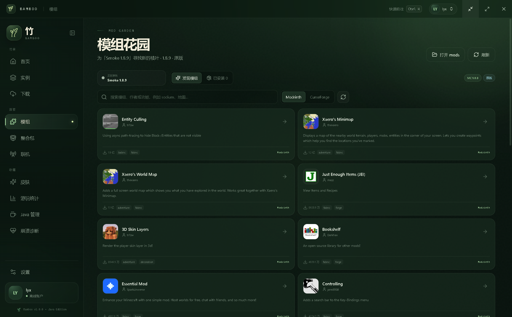
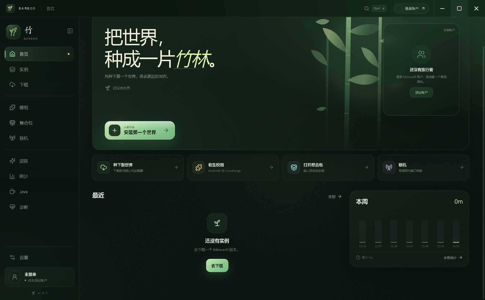

# Bamboo 验证报告

> 验证日期：2026-10-25  
> 验证环境：Windows 10.0.26300（x64）、Electron 37.10.3 / Chromium 138、Node.js 24.21（构建）/ Electron Node 22.21（运行）、150% 系统缩放。  
> 说明：本环境通过 DSH 桌面会话启动，Electron 必须以 `--no-sandbox` 运行；这不是 Bamboo 的默认行为。普通桌面用户直接双击 `Bamboo.exe` 即可。

## 1. 静态检查

| 项目 | 命令 | 结果 |
| --- | --- | --- |
| TypeScript（主进程 + 渲染进程） | `pnpm typecheck` | 通过（exit 0） |
| 生产构建 | `pnpm build` | 通过（exit 0） |
| 主进程 bundle | — | 约 1.51 MB（依赖一并打包） |
| 渲染进程 JS | — | 约 1.01 MB |
| UI 全页截图 | Playwright + Edge | 11 个页面均渲染；控制台仅 favicon 404，已补 favicon |

截图目录：[docs/screens](screens/)。

## 2. 真实游戏链路

### 2.1 Java 下载

- 操作：`window.bamboo.downloadJava(8)`
- 结果：`success`
- 用时：约 **13.5 秒**
- 运行时：Mojang `jre-legacy`，`1.8.0_51`
- 路径：`data/java/mojang/jre-legacy/bin/java.exe`
- 校验：运行时文件 208 个；启动器可识别并显示在 Java 管理页。

### 2.2 游戏核心安装

- 版本：Minecraft **1.8.9**，原版。
- 首次安装进行到约 760 个文件 / 145 MB 时，因高频进度事件导致运行不稳定；随后：
  - 在主进程加入 120ms 进度节流；
  - 重新运行安装，复用已有文件，约 **6.9 秒** 完成。
- 结果：`success`，创建实例 `Smoke 1.8.9`，版本 ID `1.8.9`。
- 生成文件：`versions/1.8.9/1.8.9.jar`、`1.8.9.json`、libraries、assets 索引与 objects。

> 复现命令见 `scripts/integration-install.mjs`（需先用 `--remote-debugging-port` 启动应用）。

### 2.3 启动

- 操作：`window.bamboo.launch(instanceId)`
- 结果：`success`
- 进程 PID：19848（测试会话）
- 窗口就绪：约 **2.4 秒**（Java 进程启动 → `minecraft-window-ready`）
- 游戏进程：`java.exe`，窗口标题 `Minecraft 1.8.9`，工作集约 1.1 GB
- 版本参数：`--username lyx --version 1.8.9 --gameDir ... --assetsDir ... --uuid ...`
- 会话记录：成功写入 `sessions`，游玩时长与实例累计同步更新。
- 用户关闭游戏后，进程退出码 0，不被判为崩溃。

### 2.4 加载器安装

**Forge**

- 版本：Forge **1.8.9-11.15.0.1656**
- 安装器 URL：`https://maven.minecraftforge.net/net/minecraftforge/forge/1.8.9-11.15.0.1656/forge-1.8.9-11.15.0.1656-installer.jar`
- 使用 Java 8 执行安装 profile / processors。
- 结果：返回版本 ID `1.8.9-forge1.8.9-11.15.0.1656`，版本 JSON 已生成。
- 复现：`node scripts/test-forge.cjs`（临时目录）。

**Fabric**

- 1.20.1 + Fabric Loader `0.15.11`
- 获取 Fabric Meta artifact：mainClass `net.fabricmc.loader.impl.launch.knot.KnotClient`
- 生成版本 JSON：`1.20.1-fabric0.15.11`，`inheritsFrom=1.20.1`，8 个库。
- 结果：版本 JSON / 继承关系正确；完整启动未测（还需对应 1.20.1 核心与资源）。

**LiteLoader**

- 1.8.9 官方仅有 snapshot 版本。
- 读取到 `1.8.9-SNAPSHOT`，安装返回 `1.8.9-Liteloader1.8.9-1.8.9-SNAPSHOT`。
- 版本 JSON 生成成功，`inheritsFrom=1.8.9`。
- 这说明 LiteLoader 的“版本列表 → 安装 → 版本 JSON”链路可用。

> UI 的加载器安装路径复用同一 xmcl 安装器与版本列表，并增加 Java 选择、进度事件与失败提示。

## 3. 生态 API

### 3.1 版本清单

- Mojang 清单可访问，返回 **920** 个版本。
- 测试时最新正式版为 `26.3`；Bamboo 已按 26.x → Java 25 映射。
- 加载器列表：
  - Fabric 1.20.1：60 个 loader 版本，首个稳定版 `0.20.1`。
  - Forge 通过 Maven metadata + promotions 获取推荐/最新。
  - Quilt / NeoForge / LiteLoader 均有独立实现。

### 3.2 Modrinth

- 搜索 `sodium`（1.21.4, Fabric）：35 个结果。
- 首屏结果：Sodium、Sodium Extra、Reese's Sodium Options 等。
- Sodium 在 1.21.4 / Fabric 下返回 8 个版本。
- 最新文件名：`sodium-fabric-0.6.13+mc1.21.4.jar`，包含可下载 URL。
- 在真实打包版中打开「模组」页，Modrinth 结果与图标均正常加载（见 `docs/screens/packaged-home.png`）。

### 3.3 CurseForge

- 未配置 API Key 时，搜索返回 `needsApiKey: true` 与中文引导，不崩溃。
- 配置 Key 后使用官方 `x-api-key` 请求；无效 Key 会得到明确错误。
- 下载地址为空的文件会尝试构造 ForgeCDN 直链；仍失败则报告给用户。

### 3.4 整合包

- 解析器覆盖：
  - Modrinth `modrinth.index.json`；
  - CurseForge `manifest.json`；
  - MultiMC / Prism `mmc-pack.json`。
- 解压 overrides 时执行路径穿越校验（`isSafeChild`），拒绝 zip-slip。
- 拖入窗口后自动识别并安装。

## 4. 离线皮肤桥

测试账户：`BambooLeaf`，离线，皮肤模型 slim，PNG 785 字节。

1. 启动时成功下载 `authlib-injector.jar`（349,681 字节），修复了早期版本将目标路径错误创建为目录的问题。
2. 游戏命令行中确认存在：
   - `-javaagent:...\authlib-injector.jar=http://127.0.0.1:4335`
   - `-Dauthlibinjector.side=client`
   - `--accessToken bamboo-local-...`
3. 本地 Yggdrasil 元数据：
   - `serverName = Bamboo Local Skin Bridge`
   - `skinDomains = ["*"]`
4. Profile 端点返回：
   - `id = 20407fd64384358da25c3b52a40bbe4b`
   - `name = BambooLeaf`
   - `textures` / `uploadableTextures` 属性
5. 使用元数据公钥验证 `RSA-SHA1` 签名：**valid**。
6. 纹理端点返回 785 字节 PNG，头部校验通过。
7. 游戏窗口进入 `running`，未出现“离线皮肤未启用”警告。

> 注意：这是实验性能力，仅在 1.8.9 做了完整验证；不同版本/服务端对 javaagent 的兼容性可能不同。实例设置可关闭。

## 5. UI 验证

使用 Playwright + Edge 以 1440×900 截取全部页面：

- 首页、实例、下载、模组、整合包、联机、皮肤、游玩统计、Java 管理、崩溃诊断、设置；
- 账户弹窗、命令面板（Ctrl+K）；
- 真实 Electron 窗口与打包版窗口（2130×1320 物理像素）。

已修复：

- 全页 `Segmented` 在皮肤模型行被纵向拉伸；
- 首页竹枝图形被账户卡完全遮挡；
- favicon 404；
- 任务进度高频事件造成的渲染压力；
- 强制结束游戏被误记为崩溃；
- authlib-injector 目标路径被创建为目录导致皮肤下载失败。

## 6. 打包验证

- 便携版通过 `scripts/package-portable.mjs` 生成：
  - 复制 Electron 运行时；
  - 用 `asar` 打包 `out/` 与 `package.json`；
  - 写入 `resources/icon.png`；
  - 重命名 `Bamboo.exe` 并用 `rcedit` 写入图标与版本信息；
  - 生成 zip。
- `app.asar`：**2.57 MB**（依赖已打包进主进程）。
- zip：**124.92 MB**，共 78 个文件。
- `Bamboo.exe` 文件版本与产品版本均为 **1.0.1**。
- 打包版 `Bamboo.exe` 可启动，能读取真实账户与实例数据、加载真实 Modrinth 搜索结果，窗口标题 `Bamboo · 模组`。
- 最终打包版在 **不设置 `BAMBOO_USER_DATA`** 的情况下也成功启动：
  - 本环境 `%APPDATA%\Bamboo` 不可写；
  - 启动器自动回退到 `release\Bamboo-Portable\BambooData\data`；
  - 窗口标题 `Bamboo · 首页`，Bootstrap 正常返回。
- 由于测试环境要求，打包版启动时额外传入 `--no-sandbox`；普通用户不需要。
- 便携版未签名，SmartScreen 可能提示未知发布者。

### 6.1 最终打包版功能检查

| 检查 | 结果 |
| --- | --- |
| 合成 Modrinth `.mrpack` 解析 | `format=modrinth`、`mcVersion=1.20.1`、`loader=fabric 0.15.11` |
| Modrinth 实时搜索 | 52 条结果，Fabric API 置顶 |
| 网络信息 | 主机名、`192.168.10.100` 正常返回 |
| LAN 发现 | `discoverLanWorlds()` 正常返回空数组，无异常 |
| 功能入口隐藏 | 隐藏模组后导航计数 0；恢复后计数 1 |
| 用户数据回退 | AppData 不可写时自动落到 `BambooData` |
| 最终 zip 内 `Bamboo.exe` 启动 | Bootstrap 返回 `dataRoot=.bamboo-101-test\data`、`appVersion=1.0.1`、`theme=bamboo` |
| 游戏运行时关闭窗口 | 收起到系统托盘并显示气泡；可从托盘恢复或退出（代码路径） |

### 6.2 v1.0.1 界面与更新检查

| 检查 | 结果 |
| --- | --- |
| 侧栏展开 / 收起 | 宽度从 232px 平滑过渡到 80px；文字、品牌与账户信息独立淡出，无闪烁（见 [sidebar-compact.png](screens/sidebar-compact.png)） |
| 界面降噪 | 移除分组标签、英文 overline、页面重复说明；导航与页面标题缩短 |
| 窗口控制 | 最小化 / 最大化 / 关闭图标加粗至 2.2–2.5px，按钮宽度 50px，增加悬停反馈与原生 tooltip |
| 启动进度 | 竹节进度条 + 浮叶 + 检查 / 准备 / 启动三阶段；读取真实 job progress（3/18/46/82%） |
| 更新检查 | 当前 `1.0.1`，查询 GitHub Releases、GitHub `main` 的 `package.json`、官网版本页与下载页；无新版本时返回 `available=false` |
| 更新提示 UI | 模拟 `1.0.2` 时显示“可更新至 v1.0.2”、GitHub 来源、检查 / 下载按钮；toast 提供跳转（见 [update-available.png](screens/update-available.png)） |
| 联系作者 | 设置页底部显示 `Ti68281@xbkjz.icu` 与 `xiaobao@xbkjz.cn`，点击复制并提示（见 [settings-contact.png](screens/settings-contact.png)） |
| 自动检查开关 | 设置 → 自动检查更新，默认开启；关闭后启动不发起请求 |

> 更新下载/安装未做端到端验证：仓库当前没有发布资产，且不能为了测试伪造线上 release。检查逻辑、更新 UI 与下载代码路径已分别验证。

## 7. 未完成 / 未验证项

| 项 | 状态 | 原因 |
| --- | --- | --- |
| Microsoft 登录端到端 | 未验证 | 需要真实 Azure 应用 ID 与 Microsoft 账号，不能使用他人凭据 |
| CurseForge 实际搜索/下载 | 未验证 | 需要用户自己的 API Key |
| Fabric / Quilt / NeoForge / LiteLoader 完整启动 | 部分验证 | Forge 1.8.9 端到端启动已验证；Fabric 与 LiteLoader 的安装/版本 JSON 已验证；Quilt / NeoForge 未逐一安装 |
| UPnP 公网联机 | 未验证 | 依赖真实路由器与公网环境 |
| 在线整合包搜索安装 | 未实现 | 本版本以拖入整合包 + Modrinth/CurseForge Mod 搜索为主 |
| macOS / Linux 打包 | 未验证 | 当前交付为 Windows 便携版 |
| 全量高清皮肤（128×128） | 不支持 | 原版仅识别 64×64 / 64×32，Bamboo 做了严格校验 |

## 8. 复现与日志

| 内容 | 文件 |
| --- | --- |
| Java / 核心 / 启动流程 | [evidence/integration-install2.log](evidence/integration-install2.log)、`scripts/integration-install.mjs` |
| Forge 安装 | [evidence/forge-test.log](evidence/forge-test.log)、`scripts/test-forge.cjs` |
| 皮肤桥启动 | [evidence/skin-launch3.log](evidence/skin-launch3.log)、`scripts/test-skin-launch.mjs` |
| 最终打包 | [evidence/package-final5.log](evidence/package-final5.log) |
| 最终冒烟测试 | [evidence/final-smoke.log](evidence/final-smoke.log)、`scripts/final-packaged-smoke.mjs` |
| Fabric 版本生成 | [evidence/fabric-test.log](evidence/fabric-test.log) |
| LiteLoader 元数据 / 安装 | [evidence/liteloader-test.log](evidence/liteloader-test.log)、[liteloader-install-test.log](evidence/liteloader-install-test.log) |
| 最终产物启动 | [evidence/final2.log](evidence/final2.log) |
| v1.0.1 更新检查 | [evidence/update-test.log](evidence/update-test.log) |
| v1.0.1 打包启动 | [evidence/packaged-101-check.log](evidence/packaged-101-check.log) |
| 侧栏动画测量 | [evidence/ui-transition2.log](evidence/ui-transition2.log) |
| 启动进度预览 | [evidence/launch-preview.log](evidence/launch-preview.log) |
| UI 全页截图 | [screens/](screens/)、`scripts/capture-ui.mjs` |
| 便携版 | `release/Bamboo-Portable/`、`release/Bamboo-Portable-1.0.1.zip` |

> 完整测试数据目录 `.bamboo-*` 不属于发布物；交付 zip 中只包含 Electron 运行时、`app.asar`、图标与 `README.txt`。
